# KČT-like mapové značky
 
Reimplementace mapových značek používaných v turistických mapách Klubu českých turistů.
 
Nejde o jejich kopii, nýbrž o vlastní nápodobu turistických značek používaných v těchto mapách, proto jsou označovány jako 'KČT-like mapové značky'.
 
Sada obsahuje 90 bodových mapových značek ve formátu SVG. Značky v této sadě vznikly vlastním překreslením podle obecně zavedené podoby těchto symbolů, nikoli kopírováním grafiky. Tato sada není oficiálním produktem Klubu českých turistů ani s ním není spojená. Název KČT je použit pouze pro označení, jakému stylu map se značky podobají.

## Přehled značek

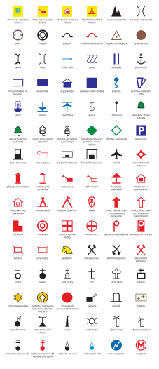

## Seznam značek
 
| | soubor | značka |
|:-:|---|---|
|  | `01_cyklo_informace.svg` | informace (cyklisté vítáni) |
| 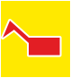 | `02_cyklo_restaurace.svg` | restaurace (cyklisté vítáni) |
| 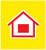 | `03_cyklo_ubytovani.svg` | ubytování (cyklisté vítáni) |
| 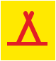 | `04_cyklo_taboriste.svg` | tábořiště (cyklisté vítáni) |
|  | `05_osamocena_skala.svg` | osamocená skála |
|  | `06_prusmyk_sedlo.svg` | průsmyk nebo sedlo |
|  | `07_zavrt.svg` | závrt |
| 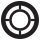 | `08_propast.svg` | propast |
|  | `09_jeskyne.svg` | jeskyně |
|  | `10_jeskyne_prohlidkova.svg` | prohlídková jeskyně |
| 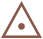 | `11_trigonometricky_bod.svg` | trigonometrický bod |
| 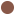 | `12_vyskova_kota.svg` | výšková kóta |
|  | `13_lavka.svg` | lávka |
|  | `14_most.svg` | most |
|  | `15_smer_toku.svg` | směr toku |
|  | `16_perej.svg` | peřej |
|  | `17_vodopad.svg` | vodopád |
|  | `18_pristaviste.svg` | přístaviště |
|  | `19_misto_ke_koupani.svg` | místo vhodné ke koupání |
|  | `20_koupaliste.svg` | koupaliště |
|  | `21_kryty_bazen.svg` | krytý bazén |
|  | `22_vodojem_studna.svg` | vodojem nebo studna |
|  | `23_pramen.svg` | pramen |
|  | `24_pramen_mineralni.svg` | pramen minerální vody |
|  | `25_lazne.svg` | lázně |
|  | `26_ponor.svg` | ponor |
|  | `27_vyveracka.svg` | vyvěračka |
|  | `28_vinice.svg` | vinice |
|  | `29_chmelnice.svg` | chmelnice |
|  | `30_pamatny_strom_listnaty.svg` | památný strom listnatý |
| 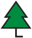 | `31_pamatny_strom_jehlicnaty.svg` | památný strom jehličnatý |
|  | `32_strom_s_obrazkem_listnaty.svg` | strom s obrázkem (listnatý) |
|  | `33_strom_s_obrazkem_jehlicnaty.svg` | strom s obrázkem (jehličnatý) |
| 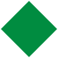 | `34_prirodni_rezervace_mensi.svg` | přírodní rezervace / památka menší rozlohy |
|  | `35_prirodni_zajimavost.svg` | přírodní zajímavost |
|  | `36_parkoviste.svg` | parkoviště |
|  | `37_cerpaci_stanice.svg` | čerpací stanice |
|  | `38_zakaz_vjezdu.svg` | zákaz vjezdu |
|  | `39_zeleznicni_stanice.svg` | železniční stanice |
|  | `40_zeleznicni_zastavka.svg` | železniční zastávka |
|  | `41_letiste.svg` | letiště |
|  | `42_misto_dalekeho_rozhledu.svg` | místo dalekého rozhledu |
|  | `43_rozhledna_pristupna.svg` | přístupná rozhledna |
|  | `44_rozhledna_nepristupna.svg` | nepřístupná rozhledna |
|  | `45_restaurace.svg` | restaurace |
|  | `46_obcerstveni.svg` | občerstvení |
|  | `47_turisticky_pristresek.svg` | turistický přístřešek |
|  | `48_ubytovani_se_stravovanim.svg` | ubytování se stravováním |
|  | `49_ubytovani_bez_stravovani.svg` | ubytování bez stravování |
|  | `50_autokempink.svg` | autokempink |
|  | `51_verejne_taboriste.svg` | veřejné tábořiště |
|  | `52_bivak.svg` | bivak |
|  | `53_hrad_zamek_pristupny.svg` | hrad, zámek nebo tvrz veřejnosti přístupné |
|  | `54_hrad_zamek_nepristupny.svg` | hrad, zámek nebo tvrz veřejnosti nepřístupné |
|  | `55_zricenina.svg` | zřícenina |
|  | `56_hradisko.svg` | hradisko |
|  | `57_stanice_horske_sluzby.svg` | stanice horské služby |
|  | `58_nemocnice.svg` | nemocnice |
|  | `59_autobusova_zastavka.svg` | autobusová zastávka |
|  | `60_autobusove_nadrazi.svg` | autobusové nádraží |
|  | `61_bunkry.svg` | bunkry |
|  | `62_pevnustky.svg` | pevnůstky |
|  | `63_jezdectvi.svg` | jezdectví |
|  | `64_dul_v_provozu.svg` | důl v provozu |
|  | `65_dul_mimo_provoz.svg` | důl mimo provoz |
|  | `66_dul_verejne_pristupny.svg` | důl veřejně přístupný |
|  | `67_kostel.svg` | kostel |
|  | `68_kaple.svg` | kaple |
| 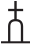 | `69_bozi_muka.svg` | boží muka |
|  | `70_kriz.svg` | kříž |
|  | `71_smirci_kriz.svg` | smírčí kříž |
|  | `72_klaster.svg` | klášter |
|  | `73_zidovska_pamatka.svg` | židovská památka |
|  | `74_unesco.svg` | památka světového kulturního dědictví UNESCO |
|  | `75_pozoruhodne_misto.svg` | všeobecně pozoruhodné místo |
|  | `76_hajovna.svg` | hájovna |
|  | `77_pomnik.svg` | pomník |
| 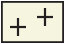 | `78_hrbitov.svg` | hřbitov |
|  | `79_transformator.svg` | transformátor |
|  | `80_meteorologicka_stanice.svg` | meteorologická stanice |
|  | `81_komin.svg` | komín |
|  | `82_vodni_mlyn.svg` | vodní mlýn |
|  | `83_vetrny_mlyn.svg` | větrný mlýn |
|  | `84_vetrna_elektrarna.svg` | větrná elektrárna |
|  | `85_telekomunikacni_vez.svg` | telekomunikační věž |
|  | `86_telekomunikacni_vez_pristupna.svg` | telekomunikační věž veřejně přístupná |
|  | `87_vezovita_stavba.svg` | věžovitá stavba |
|  | `88_vodarenska_vez.svg` | vodárenská věž |
|  | `89_vodni_elektrarna.svg` | vodní elektrárna |
|  | `90_muzeum.svg` | muzeum |

 
## Licence
 
Značky jsou uvolněny pod licencí **CC BY-NC 4.0**.
 
Plné znění viz soubor [LICENSE](LICENSE).
